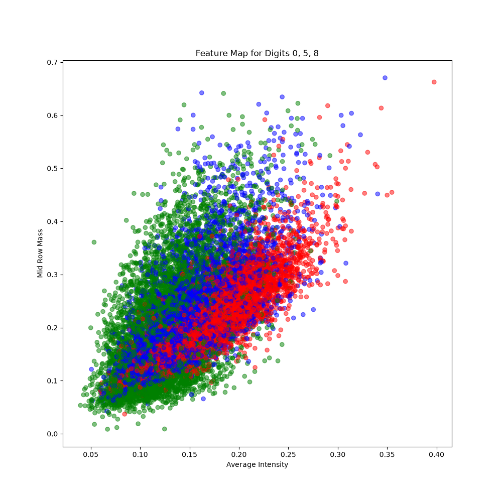
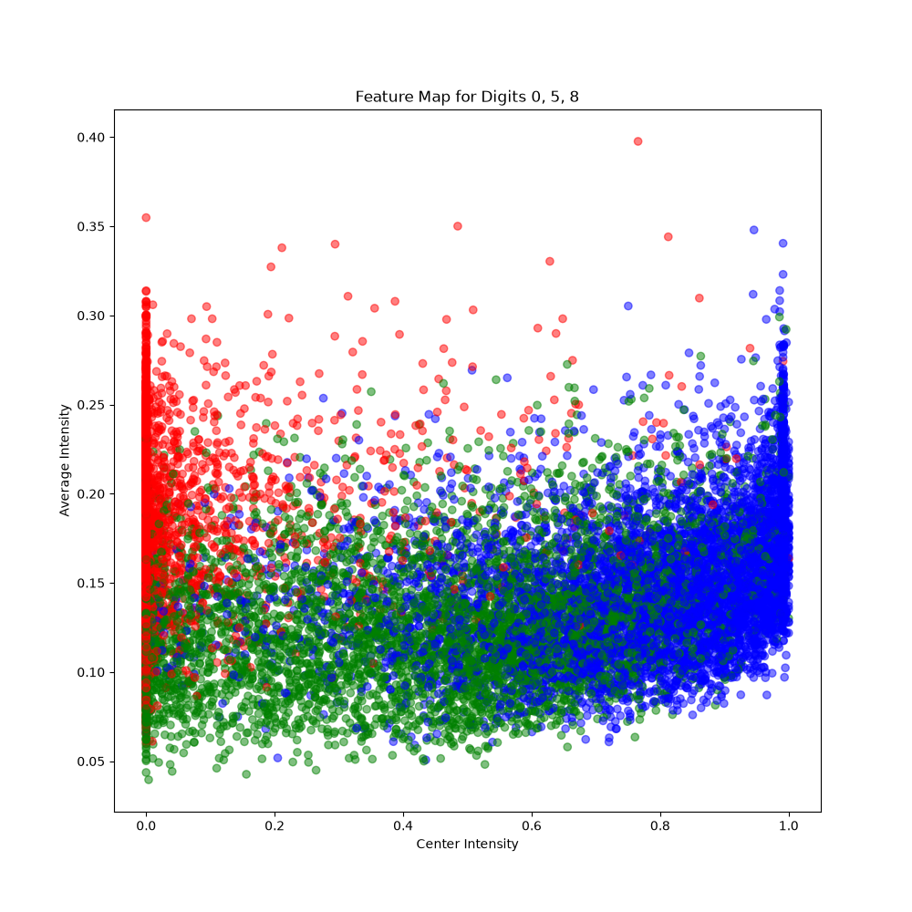
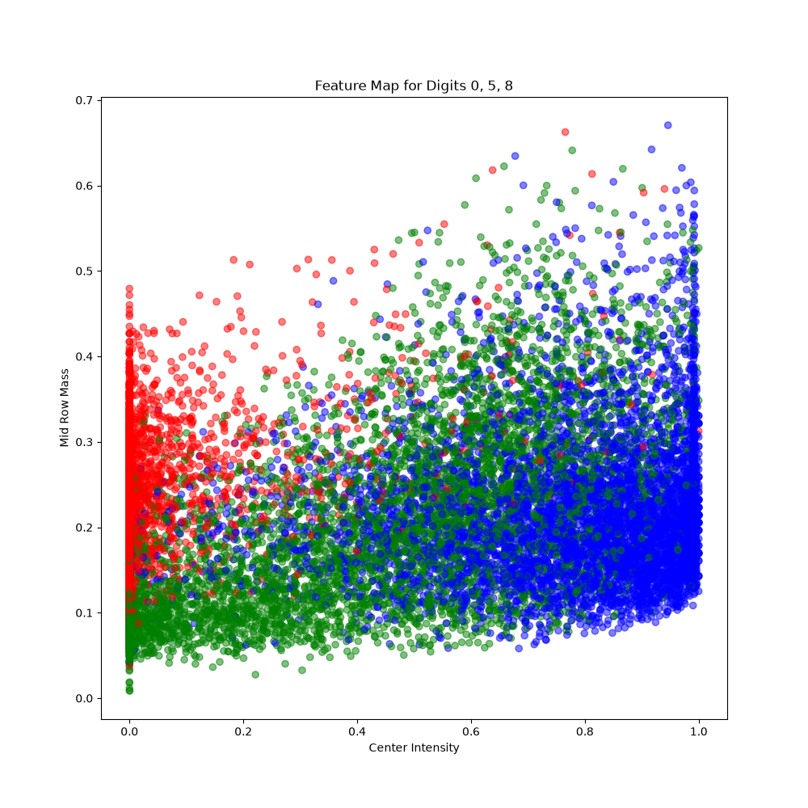

# EEC289Q: Modeling and Optimization for Computer Engineers

# Homework 1

**Name:** Tzi Hwee Chew
**Student ID:** 927429340

# a) Dataset

The MNIST dataset of handwritten digits is in a 28x28 pixel grid of 0~255 values. Each image has a corresponding label of the digit (0~9). The dataset has been presplit into training and testing sets, and we load the dataset using the MNIST Data Loader class from [https://www.kaggle.com/code/hojjatk/read-mnist-dataset]

For this experiment, we filter the MNIST dataset to include only images labeled 0, 5, and 8. The remaining digits are excluded from both training and testing.

# b) Preprocessing

We apply normalization to the pixels to scale the values to the range [0,1] by dividing each pixel value by 255.

$$
x_{\text{normalized}} = \frac{x}{255}
$$

Given that we are trying to interpret 0, 5 and 8 using 3 values, we need to pick such features that will be unique enough to be seperatable by our perceptron.
We picked the following:

- Average Intensity of the center 3x3 pixels $$ f_2 = \frac{1}{9}\sum_{r=13}^{15}\sum_{c=13}^{15}I_{r,c} $$
- Average Intensity of the image $$ f_1 = \frac{1}{784}\sum_{r=0}^{27}\sum_{c=0}^{27}I_{r,c} $$
- Average of the row of the pixels $$ f_3 = \frac{1}{28}\sum_{c=0}^{27}I_{14,c} $$

For our labels, depending on the digit, we assign a binary label, where 1 indicates the correct digit (0/5/8) and -1 indicates the incorrect digit, which is the digits that are not being classified.

Plotting the features with each axis representing a feature and the color as the label, we can see the features are NOT linearly seperable, but still have some seperation between the classes.

We process the images of the dataset by extracting the features and creating a new dataset, each sample of which is a 3-dimensional vector of the features.

# c) Labels for each digit classifier

From the MNIST Training set, we will split it into 5 equal subsets for cross-validation. We will keep out the test set for final evaluation of our model.

For each digit classifier model, we first create a new label set where the samples of the digit being classified are labeled as 1, and all other samples are labeled as -1.

$$
y_i =
\begin{cases}
+1, & \text{if digit } i \text{ is the target digit}\\
-1, & \text{otherwise}
\end{cases}
$$

We then train our perceptron model using the training set with 5-fold cross-validation, which involves using 4 of the subsets for training and 1 subset for validation, and repeating this process 5 times, each time using a different subset for validation.

# d) Training and Validation

We will be using the Sign() activation function in our perceptron.

For each epoch of 1000 epochs:
Our model with weights and biases of

$$
X = \begin{bmatrix}f_1\\f_2\\f_3\\1\end{bmatrix},
\qquad
W = \begin{bmatrix}w_1\\w_2\\w_3\\b\end{bmatrix}
$$

will be trained using the following update rule:
We predict the output using $$ y_pred = \operatorname{sign}(W^T X_i)$$
Using the predicted output, we will update our weights as follows

$$
W \leftarrow
\begin{cases}
W+y_iX_i, & y_pred_i\neq y_i\\
W, & y_pred_i=y_i
\end{cases}
$$

We then define our error function as the number of misclassified samples in our training and validation set, and we save the error for each epoch.

$$
E = \sum_{i=1}^{N}\mathbb{1}(\hat{y}_i\neq y_i)
$$

The original validation dataset is then used as our test set to evaluate the performance of our model in terms of "accuracy", which is defined as

$$
\text{Accuracy} =
\frac{1}{N}\sum_{i=1}^{N}
\mathbb{1}(\hat{y}_i=y_i)
$$

Using our test set, we can find the following accuracies for each digit classifier:

| Digit | Accuracy |
| ----- | -------- |
| 0     | 92.25%   |
| 5     | 70.34%   |
| 8     | 82.04%   |

And our cross-validation error is defined as the average of the error of each fold:

$$
\overline{E}(t) =
\frac{1}{5}\sum_{k=1}^{5}E_k(t)
$$

The code for the perceptron model can be found in the `main.py` file.

# e) Linear Regression

For our Linear Regression model, we create a new set of labels with the classifying digit as 1 and the others as 0. We use the same 5-fold cross-validation method. But we removed the Sign() activation function.

$$
y_i =
\begin{cases}
1, & \text{if the sample belongs to the target digit}\\
0, & \text{otherwise}
\end{cases}
$$

For each epoch of 1000 epocs:
We predict the outputs using $$ y_pred = W^T X_i $$
We use MSE as our loss function, which is defined as

$$
\text{MSE} =
\frac{1}{N}\sum_{i=1}^{N}(y_pred_i-y_i)^2
$$

And we update our weights with the following

$$
\nabla_W\text{MSE} =
\frac{2}{N}\sum_{i=1}^{N}
(y_pred_i-y_i)X_i
$$

$$
W \leftarrow W-\nabla_W\text{MSE}
$$

Since this is a linear regression model, we use a threshold of 0.5 to classify the outputs as 1 or 0, which is rounding up the numbers.
Using our test set, we can find the following accuracies for each digit classifier:

| Digit | Accuracy |
| ----- | -------- |
| 0     | 92.66%   |
| 5     | 71.97%   |
| 8     | 83.85%   |

The code for the linear regression model can be found in the `regression.py` file.

# f) Learnings

## Choosing Features

Before deciding on the final 3 features, I experimented with other features such as Horizontal Symmetry and Vertical Symmetry, but due to the nature of the digits, namely 0 and 8 being symmetrical on both axes, they were not seperable. Yieling a accuracy of 68.85. Effectively being random as the model was unable to learn the difference between the digits.

I find it very hard to find features that are unique enough to be seperatable by a perceptron without using a more complex algorithm, such as counting the number of holes and coutour detection, which would defeat the purpose of the perceptron and is prone to errors.

## Perceptron vs Linear Regression

Our training results show a slight improvement in classification accuracy when using linear regression models compared to perceptron models, with improvements ranging from 0.41% to 1.81 percentage points. The digit-8 classifier shows the largest improvement.

From the error plots, we observe that both models show little improvement after approximately 100 epochs, suggesting that further training provides diminishing returns.

A possible explanation for the difference in performance lies in the optimization objectives of the two models. The perceptron only updates its weights when a sample is misclassified. Since our features are not linearly separable, the perceptron may continue updating its weights without significantly reducing the classification error. In contrast, linear regression uses gradient descent to minimize the Mean Squared Error (MSE), allowing it to approach a more stable solution.

Ultimately, the limited improvement in both models is likely due to our chosen features, which do not provide sufficient information to clearly separate the three digits using linear decision boundaries. This suggests that feature selection plays a significant role in the performance of linear classifiers.
